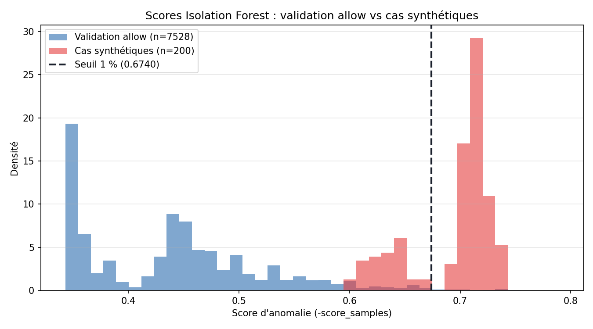

# Anomalie Réseaux

Mini-hackathon Data & IA (HETIC) — Détection d'anomalies dans des journaux de pare-feu, en local.

## Équipe, rôles & branches Git

| Membre | Branche | Rôle | Fichiers principaux |
| --- | --- | --- | --- |
| **Aymen** | `aymen` | Données & Exploration | `data/log2.csv`, `features.py`, `explore.py`, `artifacts/*.png` |
| **Justin** | `justin` | Modèle IA | `train.py`, `artifacts/model.joblib` |
| **Nassima** | `nassima` | Application (API + UI) | `api.py` (FastAPI), `app.py` (Streamlit) |
| **Quentin** | `quentin` | DevOps, Tests & Intégration | `tests/`, `Dockerfile`, `docker-compose.yml` |

- **`staging`** : branche d'intégration et de tests avant fusion dans `main`.
- **`main`** : version stable prête pour la soutenance.

## Flux de travail Git

```
branche perso  ──PR──►  staging  ──PR──►  main
(aymen, justin,        (intégration       (version stable,
 nassima, quentin)      et tests)          soutenance)
```

1. **Avant de commencer** : `git checkout <ma-branche>` puis `git pull origin staging` pour partir de la dernière version intégrée.
2. **Je travaille** sur ma branche perso, un commit par issue (ex. `feat: ... (#29)`).
3. **PR vers `staging`** : la description contient `Closes #n` pour fermer l'issue automatiquement au merge.
4. **Quand `staging` est vert** (tests `pytest` OK), PR de `staging` vers `main`.
5. Personne ne pousse directement sur `staging` ni `main`.

**Suivi** : les issues sont suivies dans le board GitHub Projects (colonnes *To do*, *In progress*, *Review*, *Done*).

## Sujet & jeu de données (P1 — Données)
- **Nom du jeu** : *Internet Firewall Data* — [UCI Machine Learning Repository (dataset 542)](https://archive.ics.uci.edu/dataset/542/internet+firewall+data) (**65 532 lignes** × **12 colonnes**)
- **DOI** : `10.24432/C5131M`
- **Licence & droits** : **CC BY 4.0** (Creative Commons Attribution 4.0 — réutilisation, partage et adaptation autorisés en citant la source)
- **Récupération locale (`data/log2.csv`, non versionné)** :
  1. Télécharger l'archive ZIP sur [UCI dataset 542](https://archive.ics.uci.edu/dataset/542/internet+firewall+data) (`https://archive.ics.uci.edu/static/public/542/internet+firewall+data.zip`).
  2. Extraire `log2.csv` et le placer dans `data/log2.csv` à la racine du projet.

### Description des 12 colonnes (`data/log2.csv`)
| # | Colonne brute | Rôle dans le projet | Nom contrat API |
| ---: | --- | --- | --- |
| 1 | `Source Port` | Non utilisée (port source) | — |
| 2 | `Destination Port` | Non utilisée (port destination) | — |
| 3 | `NAT Source Port` | Non utilisée (port NAT source) | — |
| 4 | `NAT Destination Port` | Non utilisée (port NAT destination) | — |
| 5 | `Action` | **Gardée à part** (filtre pour isoler `allow`, jamais en entrée du modèle) | — |
| 6 | `Bytes` | Non utilisée (redondante : `Bytes Sent + Bytes Received`) | — |
| 7 | `Bytes Sent` | **Mesure utilisée (1/4)** — octets envoyés | `bytes_sent` |
| 8 | `Bytes Received` | **Mesure utilisée (2/4)** — octets reçus | `bytes_received` |
| 9 | `Packets` | **Mesure utilisée (3/4)** — nombre total de paquets | `packets` |
| 10 | `Elapsed Time (sec)` | **Mesure utilisée (4/4)** — durée de session en secondes | `elapsed_time_sec` |
| 11 | `pkts_sent` | Non utilisée (sous-détail de `Packets`) | — |
| 12 | `pkts_received` | Non utilisée (sous-détail de `Packets`) | — |

### Premier contrôle : répartition par action (`Action`) & valeurs manquantes (D2)
Contrôle exécuté via `python explore.py` (`first_control()`) : **0 valeur manquante (`NaN`)** détectée sur l'ensemble des 12 colonnes (`65 532` lignes complètes). La classe **`allow`** (`37 640` lignes, soit `57,44 %`) constitue la référence de trafic habituel pour l'entraînement non supervisé.

| Action | Nombre de lignes | Part |
| --- | ---: | ---: |
| `allow` | **37 640** | 57,44 % |
| `deny` | **14 987** | 22,87 % |
| `drop` | **12 851** | 19,61 % |
| `reset-both` | **54** | 0,08 % |
| **Total** | **65 532** | **100,00 %** |

### Contrôle qualité & nettoyage
- **Valeurs manquantes (`NaN`)** : `0`
- **Valeurs numériques illisibles** : `0`
- **Valeurs négatives (`< 0`)** : `0` (cohérence vérifiée : `Bytes == Bytes Sent + Bytes Received` et `Packets == pkts_sent + pkts_received` sur 100 % des lignes)
- **Doublons** :
  - `8 362` doublons exacts sur les 12 colonnes (12,76 % du total : `6 945` en `deny`, `1 216` en `drop`, `201` en `allow`, `0` en `reset-both`).
  - Sur les 4 variables dans `allow` (`37 640` lignes) : `19 777` doublons (`52,54 %`, soit `17 863` profils uniques).
  - **Décision : doublons conservés.** Le fichier ne contient ni horodatage ni adresse IP : chaque ligne correspond à une session pare-feu distincte. Des trafics normaux répétitifs (notamment DNS sur le port 53) produisent naturellement les mêmes volumes ; les dédupliquer fausserait la distribution empirique apprise par le détecteur d'anomalies.

### Statistiques du trafic normal (`allow`, `n = 37 640`)
| Variable | Min | Q25 | Médiane | Q75 | P95 | P99 | Max |
| --- | ---: | ---: | ---: | ---: | ---: | ---: | ---: |
| `Bytes Sent` | 60 | 94 | **126** | 1 586 | 9 293 | 64 722 | 948 477 220 |
| `Bytes Received` | 0 | 91 | **220** | 3 063 | 58 599 | 1 225 556 | 320 881 795 |
| `Packets` | 1 | 2 | **3** | 19 | 107 | 1 469 | 1 036 116 |
| `Elapsed Time (sec)` | 0 | 27 | **30** | 49 | 360 | 1 201 | 10 824 |

- **Visualisation (D4)** : `artifacts/trafic_allow.png` (générée par `python explore.py`).
  - **Ordres de grandeur** : la majorité du trafic `allow` correspond à de petits échanges rapides (médiane à `126` octets envoyés, `220` octets reçus, `3` paquets, `30 s` de durée, dominés par le DNS port 53 et le web HTTPS/HTTP).
  - **Distributions très étalées (queue lourde)** : les volumes s'étendent sur 6 à 9 ordres de grandeur (jusqu'à `948 Mo` envoyés, `321 Mo` reçus, `1,04 M` paquets et `3 h` de session), d'où la nécessité d'une échelle logarithmique (`log10(1 + x)`) pour visualiser la distribution et de la transformation `log1p` avant Isolation Forest.
  - **Valeurs extrêmes** : dès le `99e` percentile (`P99` : `64 722` octets envoyés, `1,23 Mo` reçus, `1 469` paquets, `1 201 s`), on entre dans des transferts massifs ou sessions longues qui représentent des candidats naturels aux anomalies de volume.

### Découpage train / validation / test du trafic normal (D5)
Implémenté dans `features.py` via `split_allow(df, random_state=42, max_rows=50_000)` (signature directement importée par `train.py`) :
- **Entraînement (60 %)** : **22 584** lignes `allow`
- **Validation (20 %, réglage du seuil)** : **7 528** lignes `allow`
- **Test (20 %, évaluation finale jamais vue)** : **7 528** lignes `allow`
- **Plafond d'échantillonnage** : `50 000` lignes (non déclenché ici car `37 640 <= 50 000`), zéro recouvrement, découpage 100 % reproductible (`random_state=42`).

### Cas habituel de référence pour la démo (D6 — à utiliser par Nassima & Quentin)
Vraie ligne `allow` sélectionnée automatiquement comme la plus proche de la médiane des 4 mesures (`126`, `220`, `3`, `30`) : **index pandas `12871`** (ligne CSV `12873`, requête DNS classique sur le port destination `53`).

```json
{
  "bytes_sent": 168,
  "bytes_received": 175,
  "packets": 3,
  "elapsed_time_sec": 30
}
```

- **Vérification sur le modèle Isolation Forest (`train.py`, `log1p` + `n_estimators=200`, `random_state=42`)** :
  - Score d'anomalie obtenu : **`0.4332`** (42,9e percentile de la validation, sous la médiane `0.4410`).
  - Décision : **`is_anomaly = false`** avec une large marge, aussi bien au seuil `P99` (`0.6740`) qu'au seuil `P95` (`0.5945`).
- **Usage équipe** : valeurs prêtes à pré-remplir dans le formulaire Streamlit (Nassima — A6) et dans le test d'un flux normal côté `pytest` (Quentin).

### Comparaison trafic autorisé (`allow`) vs refusé (`deny` / `drop`) — Bonus (D7)
Analyse réalisée sans jamais utiliser `deny` ni `drop` à l'entraînement (modèle Isolation Forest entraîné uniquement sur `allow` train). Graphique généré : `artifacts/comparaison_allow_deny_drop.png`.

| Groupe | Lignes | Méd. `bytes_sent` | Méd. `bytes_received` | Méd. `packets` | Méd. `elapsed_time_sec` | Score moyen | Score médian | `> P95` (`0.5945`) | `> P99` (`0.6740`) |
| --- | ---: | ---: | ---: | ---: | ---: | ---: | ---: | ---: | ---: |
| `allow` (test) | 7 528 | 126 | 220 | 3 | 30 s | **0.4418** | 0.4424 | 4,74 % | 1,01 % |
| `deny` | 14 987 | 66 | **0** | **1** | **0 s** | **0.6168** | 0.6183 | **97,31 %** | 0,00 % |
| `drop` | 12 851 | 70 | **0** | **1** | **0 s** | **0.5932** | 0.5851 | **33,12 %** | 0,00 % |
| `deny + drop` | 27 838 | 66 | **0** | **1** | **0 s** | **0.6059** | 0.6096 | **67,68 %** | 0,00 % |

- **Ce qui distingue `deny` / `drop`** : les connexions refusées sont coupées immédiatement par le pare-feu dès le premier paquet — leur profil médian est quasi figé à `0` octet reçu, `1` paquet et `0 s` de durée (contre `220` octets reçus, `3` paquets et `30 s` pour `allow`).
- **Comportement du modèle non supervisé** : même sans jamais voir `deny`/`drop` à l'entraînement, Isolation Forest leur attribue un score moyen nettement supérieur au trafic normal (`0.6059` contre `0.4418`, soit `+0.164`), ce qui place **97,31 % des flux `deny`** (et **67,68 % de `deny + drop`**) au-dessus du seuil `P95` (`0.5945`), alors que le seuil `P99` (`0.6740`) cible plutôt les transferts `allow` à volumes extrêmes.

## Contrat commun (pour travailler en parallèle)
- **Modèle exporté** : `artifacts/model.joblib`
- **API FastAPI** :
  - `GET /health`
  - `POST /predict` — entrée JSON : `bytes_sent`, `bytes_received`, `packets`, `elapsed_time_sec` (tous `>= 0`, rejet `HTTP 422` si négatif) → sortie JSON : `score` (float) et `is_anomaly` (bool)
- **Interface** : formulaire Streamlit relié à `POST /predict` + tests `pytest` + Docker Compose

## Modèle IA — Cas synthétiques atypiques (`artifacts/cas_synthetiques.csv`)
Le jeu `log2.csv` ne contenant pas d'étiquette « attaque », 200 lignes synthétiques (50 par type, graine fixe `42`) simulent 4 comportements réseau atypiques :
- **`exfiltration`** : volume d'octets envoyés massif pour peu de données reçues, typique d'une fuite de données vers l'extérieur.
- **`flood`** : rafale de centaines à milliers de paquets quasi vides concentrés en `0 s`, caractéristique d'une saturation ou d'un scan agressif.
- **`connexion_fantome`** : session ouverte très longtemps (1 h à 4 h) avec un seul paquet échangé, typique d'une connexion maintenue anormalement en vie.
- **`telechargement_massif`** : volume d'octets reçus anormalement élevé face à un trafic sortant minime, simulant un rapatriement massif non habituel.

### Étude du taux d'alertes (0,5 %, 1 %, 2 %) et choix du seuil final
Seuils calibrés exclusivement sur `val_df` (`7 528` lignes `allow`), puis évalués sur `test_df` (`7 528` lignes `allow`) et les `200` cas synthétiques :

| Taux cible (val) | Détecteur | Seuil (val) | Fausses alertes (`test allow`) | Rappel global (synthétiques) | `exfiltration` | `flood` | `connexion_fantome` | `telechargement_massif` |
| --- | --- | ---: | ---: | ---: | ---: | ---: | ---: | ---: |
| **0,5 %** | Baseline | `3 721 432,6` | `0,60 %` (`45`) | `50,00 %` (`100/200`) | `100 %` | `0 %` | `0 %` | `100 %` |
| **0,5 %** | Isolation Forest | `0,7187` | `0,50 %` (`38`) | `25,00 %` (`50/200`) | `6 %` | `38 %` | `0 %` | `56 %` |
| **1,0 % (retenu)** | Baseline | `1 163 002,6` | `0,94 %` (`71`) | `50,00 %` (`100/200`) | `100 %` | `0 %` | `0 %` | `100 %` |
| **1,0 % (retenu)** | **Isolation Forest** | **`0,6740`** | **`1,01 %` (`76`)** | **`75,00 %` (`150/200`)** | **`100 %`** | **`100 %`** | **`0 %`** | **`100 %`** |
| **2,0 %** | Baseline | `369 063,2` | `1,98 %` (`149`) | `50,00 %` (`100/200`) | `100 %` | `0 %` | `0 %` | `100 %` |
| **2,0 %** | Isolation Forest | `0,6546` | `1,78 %` (`134`) | `78,00 %` (`156/200`) | `100 %` | `100 %` | `12 %` | `100 %` |

**Taux final retenu : `1 %` (seuil Isolation Forest `0,6740`, exporté dans `artifacts/model.joblib`).**
- À **`0,5 %`**, le seuil est trop strict : le rappel d'Isolation Forest chute à `25 %` (`6 %` seulement sur `exfiltration`, `38 %` sur `flood`).
- À **`1 %`**, Isolation Forest bondit à **`75 %` de rappel** (`100 %` sur `exfiltration`, `flood` et `telechargement_massif`) tout en maintenant les fausses alertes autour de `1 %` (`76 / 7 528`), et surpasse nettement le baseline (bloqué à `50 %` quel que soit le taux).
- À **`2 %`**, le gain de rappel est marginal (`+3` points, soit `+6` `connexion_fantome` détectées) au prix d'un quasi-doublement des fausses alertes (`76` → `134`).

### Distribution des scores Isolation Forest (`artifacts/scores_isolation_forest.png`)


- **Trafic habituel (`validation allow`)** : concentré autour de la médiane (`0,4410`), avec seulement `1,01 %` des observations au-dessus du seuil `0,6740`.
- **Cas synthétiques** : nettement décalés à droite du seuil pour `exfiltration`, `flood` et `telechargement_massif` (`100 %` détectés), tandis que `connexion_fantome` reste sous le seuil (`0 %`), ce qui illustre visuellement la séparation et la principale limite du modèle.

### Résultats finaux et limites du modèle (au seuil retenu `1 %`)

#### Comparatif Baseline vs Isolation Forest (chiffres issus de `artifacts/metrics.json`)

| Détecteur | Seuil (`val_df`) | Fausses alertes (`test allow`, `7 528`) | Rappel global (`200` synth.) | `exfiltration` | `flood` | `connexion_fantome` | `telechargement_massif` |
| --- | ---: | ---: | ---: | ---: | ---: | ---: | ---: |
| **Baseline** (`bytes_sent + bytes_received`) | `1 163 002,6` octets | **0,94 %** (`71 / 7 528`) | **50,00 %** (`100 / 200`) | `100 %` | `0 %` | `0 %` | `100 %` |
| **Isolation Forest** (`log1p` + 200 arbres) | `0,6740` | **1,01 %** (`76 / 7 528`) | **75,00 %** (`150 / 200`) | `100 %` | `100 %` | `0 %` | `100 %` |

#### Analyse des types ratés par chaque détecteur
- **Baseline (`bytes_sent + bytes_received`)** : ne regarde que le volume total d'octets. Il détecte à `100 %` les anomalies de volume (`exfiltration`, `telechargement_massif`), mais rate totalement (`0 %`) les anomalies comportementales à faible volume (`flood` et `connexion_fantome`).
- **Isolation Forest (4 mesures)** : capte `100 %` des `flood` en plus des anomalies de volume (`+25` points de rappel global pour un taux de fausses alertes quasi identique à `1,01 %`), mais rate `connexion_fantome` (`0 %` au seuil `1 %`, `12 %` au seuil `2 %`). Ces sessions ont des volumes faibles et `1` seul paquet — proches du trafic `allow` courant — et seule leur durée élevée (`1 h` à `4 h`) les distingue, ce qui ne suffit pas toujours à les isoler au-dessus du `99e` percentile.

#### Limites identifiées
1. **Rappel mesuré sur des cas synthétiques fabriqués** : `log2.csv` ne contient pas d'étiquettes d'attaques réelles ; le rappel (`75 %`) dépend donc directement des 4 profils simulés et ne garantit pas la même performance face à des attaques réelles inédites ou plus discrètes.
2. **`allow` n'est pas une vérité absolue de trafic sain** : le modèle apprend sur les flux autorisés par le pare-feu, qui peuvent déjà contenir du trafic malveillant passé inaperçu ou des transferts légitimes très volumineux (sources de fausses alertes).
3. **Sensibilité limitée sur une anomalie portée par une seule mesure** : comme le montre `connexion_fantome` (`0 %` à `1 %`), lorsqu'une seule des 4 variables est extrême tandis que les 3 autres restent banales, l'isolation en 4 dimensions peut rester sous le seuil `P99`.
4. **Absence de contexte réseau** : le modèle n'utilise ni ports, ni adresses IP, ni horodatage ; il évalue chaque session isolément sans détecter d'attaques distribuées ou répétées dans le temps.

> **Limite choisie pour la soutenance :** *« `allow` n'est pas une vérité terrain et le rappel repose sur des cas synthétiques »* — le pare-feu fournit une référence de trafic habituel (pas des attaques étiquetées), et nos `75 %` de rappel mesurent la détection de profils construits par l'équipe, illustré concrètement par les `connexion_fantome` ratées lorsque seule la durée est extrême.
